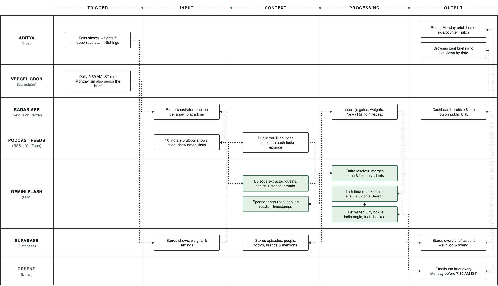

# Podcast Ecosystem Radar

**Live:** https://podcast-radar-psi.vercel.app · **Settings:** https://podcast-radar-psi.vercel.app/settings · **Components Map:** [`docs/components-map/`](docs/components-map/) (diagram PNG, PDF and HTML)

Every Monday before 7:30 AM IST, this app emails a podcast host a one-page radar built from the
last week of **live** podcast data:

- **Book this week**: the strongest guests to book (founders ahead of the curve), plus a **Doing media rounds** block
  listing every guest on 2+ monitored Indian shows in the same 30 days.
- **Topics to ride or counter**: themes several Indian shows covered this week.
- **Global signals · for inspiration**: themes trending on global shows that India hasn't picked up yet.
- **Sponsors to pitch**: brands buying spoken ad reads, including timestamped reads found by watching the YouTube video.

Every item links back to the episodes it came from ("Sources (n)"), and every score can be expanded
to show why it ranked where it did. **All AI work uses Google Gemini Flash** (model from `GEMINI_MODEL`, currently `gemini-3.8-flash`).

---

## Architecture

Next.js (App Router, TypeScript, Tailwind) on Vercel · Supabase Postgres · Gemini via `@google/genai` · Resend · Vercel Cron.

The 11 components, plus global signals:

| # | Component | Where |
|---|-----------|-------|
| 1 | **Settings dashboard**: password-protected show list, weights, deep-read cap, prices, Run now, test email | `src/app/settings/*`, `src/app/api/shows/*`, `src/app/api/settings` |
| 2 | **Orchestrator**: `GET /api/run?mode=daily\|weekly`; calls one ingest per show, 3 at a time | `src/app/api/run`, `src/lib/pipeline.ts` |
| 3 | **RSS ingest**: `POST /api/ingest/[showId]`; fetches the live feed, keeps 30 days (India/own) or 14 days (global) | `src/lib/rss.ts`, `src/lib/ingest.ts` |
| 4 | **Extraction** (Gemini, JSON schema + zod, retry once): guests, topics + stance, brands; batches of 8 | `src/lib/extract.ts`, `src/lib/gemini.ts` |
| 5 | **YouTube matching + sponsor deep-read** (Gemini watches the public video at LOW media resolution); `POST /api/deepread/[episodeId]`, one video per call, max 2 in parallel | `src/lib/youtube.ts`, `src/lib/deepread.ts` |
| 6 | **Entity resolution** (Gemini): new names vs existing canonical names → match or NEW; topic themes grouped; duplicates linked via `merged_into` (never deleted) | `src/lib/entities.ts` |
| 7 | **LinkedIn / website lookup** (Gemini + Google Search grounding); a URL is kept only if it is in the grounding sources | `src/lib/linkedin.ts` |
| 8 | **Scoring**: one pure function `score(from, to, weights, data)` used by the daily run, the brief and Explore | `src/lib/score.ts`, `src/lib/scoring-data.ts` |
| 9 | **Brief writer** (`POST /api/brief`): code ranks; Gemini writes "why now", the action and the India angle, fact-checked against each item's sources | `src/lib/brief.ts`, `src/lib/writer.ts`, `src/lib/send.ts` |
| 10 | **Email** (Resend), white single-accent design | `src/lib/email.ts` |
| 11 | **Dashboard + history**: `/` (Last Monday's brief / This week so far, date filter: a week with a stored brief shows it as written, any other range is calculated live), `/archive`, `/runs`, `GET /api/history` | `src/app/*`, `src/lib/history.ts` |
| + | **Global signals**: lead-time score for themes on 2+ global shows not yet on Indian shows | `src/lib/score.ts` |

**How a run flows:** cron → `/api/run` creates a `runs` row and answers immediately. In the background it
(1) calls `/api/ingest/[showId]` for every active show, 3 at a time; (2) calls `/api/deepread/[episodeId]`
for queued India videos, 2 at a time, while time remains (the rest wait for the next run);
(3) calls `/api/run/finalize`, which merges duplicate names, rates fit, looks up LinkedIn for gated guests,
and in **weekly** mode writes, stores and emails the brief. A show whose feed fails is recorded in
`runs.shows_failed` and named in the brief; the run carries on.

**Schedule (`vercel.json`):** daily `0 0 * * 0,2-6` (5:30 AM IST, Tue–Sun) refreshes the dashboard, with no email.
Weekly `0 0 * * 1` (Monday 5:30 AM IST) refreshes and also writes and sends the brief. Vercel Hobby crons can fire
anywhere in the scheduled hour and a run takes about 5 minutes, so the latest arrival is about 6:35 AM IST, safely before
7:30. (Firing the weekly job at 01:00 UTC, as first planned, could have landed after 7:30.)

---

## Setup

1. Create a Supabase project and run the SQL in `supabase/migrations/` in order (0001 → 0004).
2. Create a Gemini API key (Google AI Studio), a Resend API key, and a Vercel project linked to this repo.
3. Set the environment variables below in Vercel (Production + Preview) and in `.env.local` for local scripts.
4. Deploy. Open `/settings`, sign in, and press **Run now**.
5. Optional, once: build 8 weeks of history (no emails sent):
   `node --env-file=.env.local --import tsx scripts/backfill.ts`
   (flags: `--weeks 8`, `--briefs-only`, `--no-deep-read`). YouTube deep-reads only run for the most recent 2 weeks, to control cost.

### Environment variables

| Name | What it is |
|------|------------|
| `GEMINI_API_KEY` | Google Gemini API key (paid tier) |
| `GEMINI_MODEL` | Gemini Flash model id used for **every** AI call, e.g. `gemini-3.8-flash` |
| `SUPABASE_URL` | Supabase project URL |
| `SUPABASE_SERVICE_ROLE_KEY` | Supabase secret/service-role key (server only) |
| `RESEND_API_KEY` | Resend API key (sending access) |
| `BRIEF_RECIPIENT_EMAIL` | Who receives the Monday brief (comma-separate several) |
| `BRIEF_FROM_EMAIL` | Sender, e.g. `Podcast Radar <onboarding@resend.dev>` |
| `CRON_SECRET` | Random string; Vercel Cron sends it as `Authorization: Bearer …`, and internal calls use it too |
| `ADMIN_PASSWORD` | Password for `/settings` |
| `APP_URL` | Public URL, used for links in the email |

---

## Using Settings (no code, no redeploy)

Open `/settings` and enter the admin password. You stay signed in for 7 days (httpOnly cookie). Every write API checks it.

- **Shows**: add, edit, delete, or switch shows on and off inline. Saving fetches the RSS feed server-side and shows the latest
  episode title, or a clear error. Counts show `India: 10/10 · Global: 5 · Own: 1`, with a warning if India ≠ 10.
  A show with stored history can only be switched off, not deleted (history is permanent).
  Add a **YouTube channel URL** for India shows so their videos can be deep-read for sponsors.
- **Scoring weights**: one number per component, grouped, with a live "total = 100" check and **Reset to defaults**,
  plus the **Guest gate** (minimum India shows in 30 days for "Book this week").
- **YouTube deep-read & spend**: max minutes per video (0 = full video), Gemini prices per 1M tokens, and estimated spend this week and this month.
- **Run**: **Run now** (15-minute cooldown, to protect Gemini spend), **Send test email**, the time of the last run, and
  **Email the brief to** (1–5 addresses; overrides `BRIEF_RECIPIENT_EMAIL`).

---

## Scoring rubric (default weights; each group totals 100)

**Media rounds** = a guest on 2+ different India shows within 30 days of each other. For a weekly brief the guest window is
the last 30 days; for a longer date range in Explore it is the whole range.

**Guests: booking score.** Gate: on N+ distinct India shows in 30 days (spec default N = 2; **set to 1 in this deployment**, editable in Settings as "Guest gate"); not a host of a monitored show; not on the own show in the last 12 months.
- Spread 40: 1 show = 10, 2 = 20, 3 = 30, 4+ = 40
- Recency 25: share of appearances in the last 14 days × 25
- Ahead of the curve 20: 20 if ≤1 appearance before the 30-day window, 10 if 2–3, else 0
- Fit 15: Gemini 1–5 rating for an audience of independent Indian founders, scaled

**Topics: momentum score.** Gate: 2+ India shows this week, and Gemini rates the theme 3+ out of 5 for relevance to
independent Indian startup founders (religion, travel, gossip etc. are filtered out). Only shows switched on in Settings count.
- Spread 40: shows this week (cap 5) scaled
- Acceleration 30: this week's show count vs the 4-week average (cap 3×) scaled
- Gap 30: 30 if the own show hasn't covered it in 8 weeks
- Label: **counter** if 3+ shows share the same stance, else **ride**

**Sponsors: pitch score.** Gate: confidence ≥ 0.7; not the show's own product or network.
- Spend 40: any paid read = 40, organic only = 10
- Breadth 25: distinct shows in 30 days (cap 4) scaled
- Recency 20: 20 if first seen in the last 14 days, else 5
- Fit 15: Gemini 1–5 founder-audience fit, scaled

**Global signals: lead-time score.** Gate: 2+ global shows in 14 days.
- Spread 35: global shows (cap 4) scaled
- Not in India 35: 35 if 0 India shows in 30 days, 15 if 1, else 0
- India translation 30: Gemini 1–5 rating, scaled

The brief shows the top 3 guests, top 3 topics, top 3 sponsors and top 2 global signals, each tagged **New**,
**Rising** (score up) or **Repeat** against last week's brief. An item that is Repeat for the 3rd week in a row drops one
place. Every score component is stored in `content_json` and shown on the dashboard.

---

## How sources work

- Each item carries `sources: [{ show_name, episode_title, url, published_at, timestamp_seconds?, evidence }]`.
  Guests list every episode they appeared on, topics every episode that covered them, and sponsors every episode with the read.
  YouTube links open at the read (`&t=<seconds>s`).
- `evidence` is a short quote (≤ 15 words) from the show notes or video that proves the mention.
- **An item with zero sources is dropped.**
- Gemini's "why now" and India-angle lines may only use names and numbers from that item's own facts. Each line
  is checked in code; a failing line is retried once and otherwise replaced by a plain line built from the facts.
- LinkedIn: a profile link is shown as **LinkedIn** only if it appeared in Google Search grounding sources
  (`linkedin_verified = true`); otherwise **Search on LinkedIn** (a people-search URL). No emails or phone numbers are collected.

## History

Data accumulates permanently from the backfill start (Aug 17, 2026); rows in `episodes`, `mentions`, `entities` and
`briefs` are never deleted. In the dashboard's date filter, a week that has a stored Monday brief shows that brief exactly
as written; any other range (this week, last 30 days, a custom range) is recalculated live with the current weights. `GET /api/history?from=YYYY-MM-DD&to=YYYY-MM-DD&view=sent|explore`
exposes the same data.

## Tests

`npm test` runs: scoring rules and gates, weight changes changing the ranking, New/Rising/Repeat tagging,
the writer's fact-check, and a guard that fails if the other AI vendor's SDK, API host or name appears anywhere in the repo.

---

## Known limitations

- **Audio-only shows have no spoken sponsor detection.** Deep-read needs a public YouTube video (Paisa Vaisa has no
  channel, for example); those shows rely on show notes only.
- **Deep-read minute cap.** Gemini reads each video up to the cap set in Settings (currently 60 minutes, about $0.31 per video).
  Sponsor reads after the cap are missed. Set 0 to read full videos (a 3-hour episode is about 1M tokens at low resolution).
- **Vercel Hobby limits.** Crons can fire anywhere within the scheduled hour (the dashboard shows "Last refreshed").
  Functions run for at most 5 minutes, so each run deep-reads as many videos as fit and queues the rest for the next day.
  Very large feeds (20VC, about 12 MB) are slow to fetch.
- **Gemini limits.** Rate limits trigger exponential backoff; the free tier allows only 8 hours of YouTube video per day.
  This deployment uses a paid key.
- **YouTube matching** pairs RSS episodes to channel uploads by title and date (with Gemini for retitled uploads), and only
  sees each channel's 15 most recent long-form uploads.
- **LinkedIn** profiles rarely appear in Google Search grounding, so most guests get the "Search on LinkedIn" fallback.
- **Guest gate.** Across 8 weeks of history (about 120 guest appearances on 10 India shows), no guest appeared on two
  monitored shows within 30 days, so the spec's 2-show "media rounds" gate always came out empty. The gate is a Settings
  value and is set to 1 here. "Book this week" then lists the strongest recent guests: single-show guests get 10/40 spread
  points, and recency, newness and Gemini fit do the ranking. Set it back to 2 in Settings for strict media-rounds detection.
- **Google Search grounding quota.** LinkedIn/website lookups use Gemini's Google Search tool, which has its own quota.
  When it is used up, lookups stop for that run, the guest shows "Search on LinkedIn", and the next daily run retries.
- **Email sender.** Without a verified domain, Resend only delivers to the account owner's address.
- **Seed list changes.** Three seeded India shows had stopped publishing (The Barbershop, The Desi VC, 100x Entrepreneur)
  and The Ranveer Show's English feed was sparse, so they were switched off (history kept). A guest-overlap study of
  34 Indian shows (60 days, about 300 guests; `scripts/scout-list.ts`) found only 4 people on two shows. The list was
  then tuned toward founder interviews, matching the host's goal of founders who are "slightly ahead of the curve".
  Current India list: Figuring Out, WTF is with Nikhil Kamath, The Neon Show, Founder Thesis, Prime Venture Partners,
  Paisa Vaisa, Z47 Moments, Moneycontrol Podcast, YourStory (read from its YouTube channel feed) and The Ranveer Show (Hindi).
  Change them in Settings.
- **YouTube-only shows** are read from the channel's public uploads feed, which only lists the 15 newest long-form
  videos. A YouTube channel link can be pasted into Settings as a show's feed.
